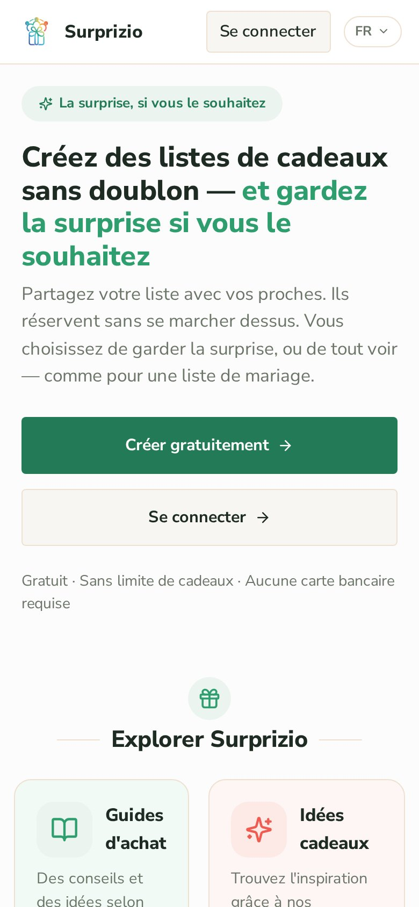
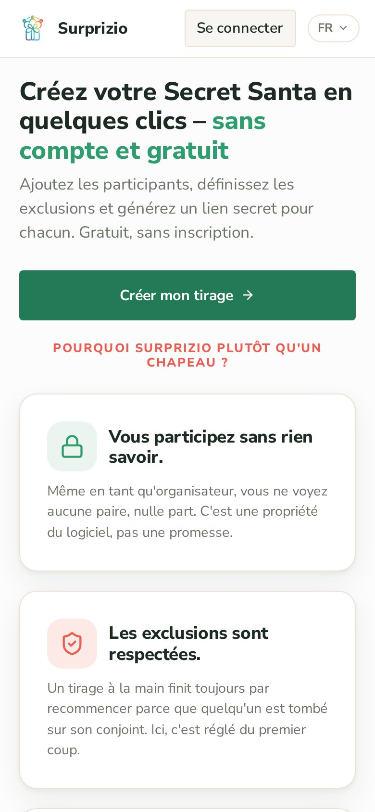
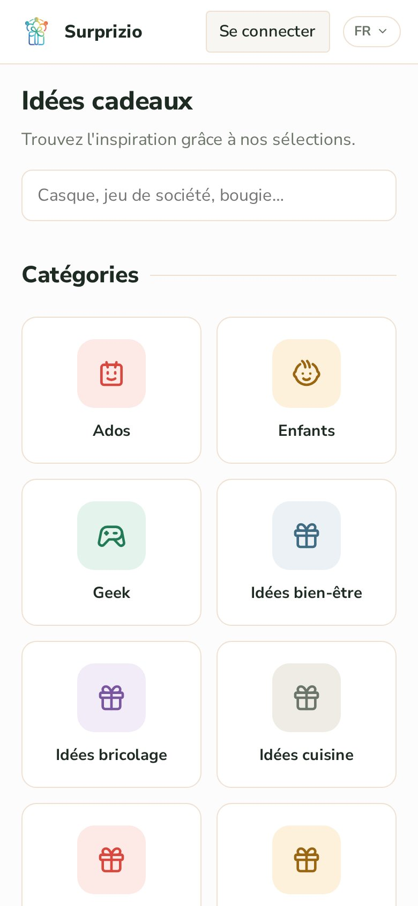
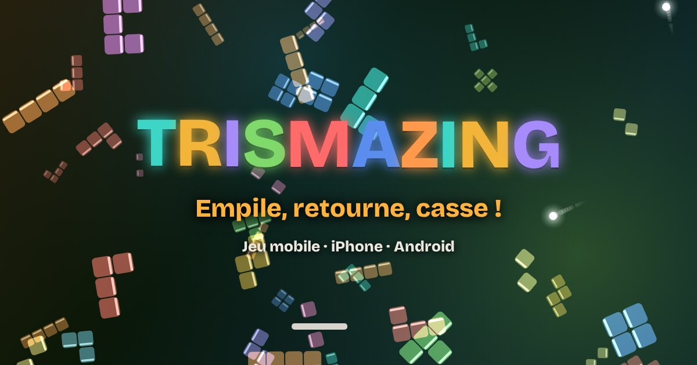
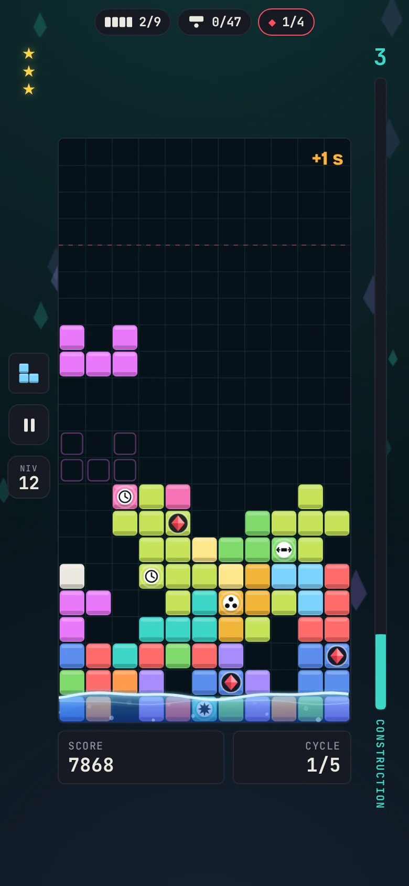
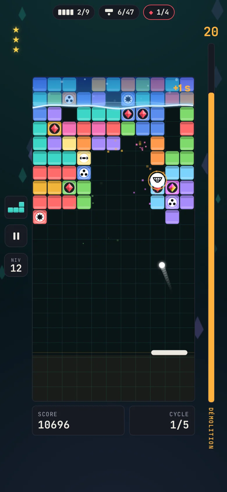
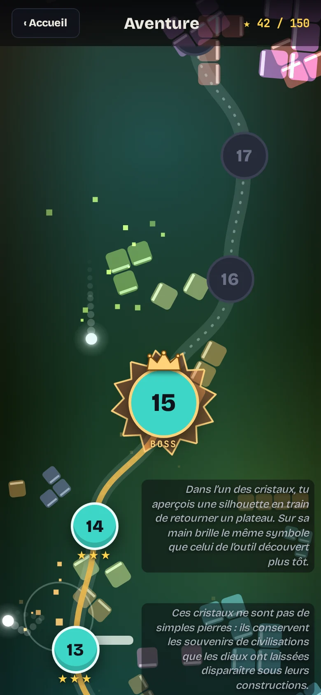

# Salut, moi c'est Cédric 👋

Développeur web indépendant, je conçois et fais tourner mes propres applications, de la première ligne de code à la mise en ligne.
Deux projets en production aujourd'hui : une application de listes de cadeaux et un jeu mobile.

---

## 🎁 Surprizio — les listes de cadeaux qui gardent la surprise

**[mysurprizio.com](https://mysurprizio.com)**

Des listes d'envies à partager avec ses proches, où personne n'offre deux fois le même cadeau, et où **le destinataire ne voit jamais ce qui a été réservé pour lui**.

- Listes partagées par lien, réservation possible sans créer de compte
- Cagnotte pour les gros cadeaux, discussion entre participants
- **Secret Santa** : tirage au sort avec exclusions, invitations par e-mail
- Extension navigateur pour ajouter un cadeau depuis n'importe quel site marchand
- Catalogue d'idées et guides d'achat, en français, anglais et italien
- Gratuit, sans publicité

  
  
  

`Symfony 7.4` `Doctrine` `MariaDB` `JavaScript vanilla` `WebExtension`

---

## 🎮 Trismazing — ce que tu construis, tu le casses

**[trismazing.com](https://trismazing.com)**

Un jeu qui mélange **Tetris** et **casse-brique** : tu empiles des pièces, puis le plateau se retourne et ta pile devient un mur de briques à démolir avec la balle.

  
  
  

- Aventure de 50 niveaux et 10 boss, avec une histoire à découvrir
- Odyssée, un mode roguelite à embranchements, plus un défi du jour et un mode infini
- Jouable hors ligne, sans publicité ni abonnement : une démo gratuite, un seul achat pour tout débloquer
- Traduit en 8 langues

**Disponible sur** [l'App Store](https://apps.apple.com/app/trismazing/id6833850146) · [itch.io](https://macload06.itch.io/trismazing) (PC et démo dans le navigateur) · Google Play très bientôt

`JavaScript` `HTML5 Canvas` `Capacitor` `Android` `iOS`

---

## 🛠️ Ma façon de travailler

- **Symfony / Doctrine** au quotidien, **JavaScript sans framework** quand c'est suffisant
- Des tests automatisés sur chaque projet, et une attention particulière à la **sécurité** et à la **confidentialité** des données
- Hébergement sur **OVH**, déploiement automatisé avec **GitHub Actions**
